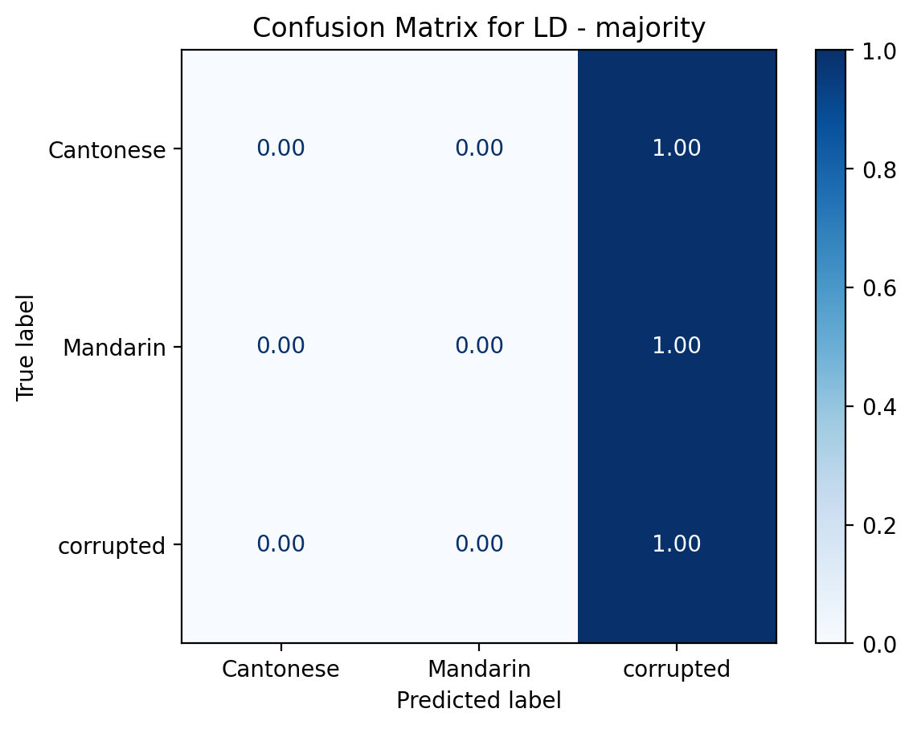
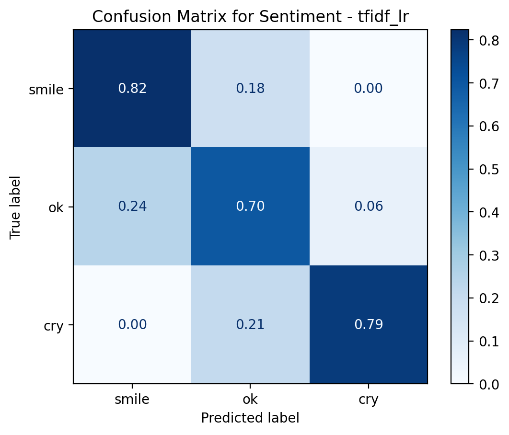
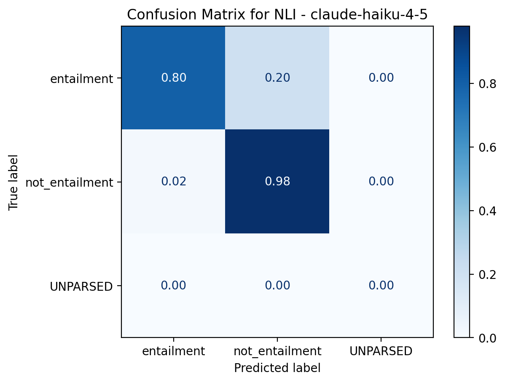

# CSCI 3052U: Benchmarking LLMs on CantoNLU

This project looks at how well large language models understand Cantonese using the CantoNLU benchmark (Min et al., 2025). We focus on three core tasks: language detection, sentiment analysis, and natural language inference. The goal is to see how LLMs stack up against simple baselines: a majority‑class guesser and a TF‑IDF + logistic regression model.

**Milestone 3** covers the baseline. This includes a working data pipeline, a naive benchmark, a course-level baseline, a reproducible environment, a baseline table and a discrepancy analysis.

**Milestone 4** adds a zero-shot LLM evaluation. This was performed on Claude Haiku 4.5 on small validation subsets. See "LLM evaluation" for details.

## Repository structure

| Folder / file | Contents |
|---|---|
| `src/data.py` | Data loaders for the three tasks and a seeded stratified sampler |
| `notebooks/` | Exploration and data-processing notebooks |
| `data/` | Data instructions (`data/README.md`) |
| `data/sample/` | Committed 100-row samples for LD, sentiment, and NLI |
| `results/` | Baseline metrics (`baselines.csv`), LLM results (`llm_val.csv` , `llm_preds.jsonl`, `llm_cache.jsonl`), and experiment logs (`runs.jsonl`) |
| `reports/` | Figures and report material |
| `requirements.txt` | Python dependencies |
| `AI_USE.md`, `CONTRIBUTIONS.md` | AI-use disclosure and contribution record |

**Note:** The CantoNLU files are cloned into `data/canto-nlu/` and are git-ignored.

## Setup

Tested on Python 3.13.

```bash
git clone https://github.com/babytara/csci3052u-cantonlu.git
cd csci3052u-cantonlu
python -m venv .venv
.venv\Scripts\activate        # Windows
# source .venv/bin/activate   # Mac / Linux
pip install -r requirements.txt
```

## Get the data

LD and sentiment come from the lab's `canto-nlu` repository, cloned into `data/canto-nlu/` and pinned to commit `2283874`. From the repository root:

```bash
git clone https://github.com/Aatlantise/canto-nlu.git data/canto-nlu
git -C data/canto-nlu checkout 2283874
```

NLI is downloaded from Hugging Face (`hon9kon9ize/yue-all-nli`, pinned to revision `f43c2e709cc3bd448a9c5d5cb5465646cd5f36bb`) when `load_nli()` is called. The first call downloads the data, this takes a few minutes. The lab repo however contains only a 100 row NLI sample, so we use the full Hugging Face data. You can see `data/README.md` for the source, licence and attribution details.

## Check that it works

From the repository root:

```bash
python -c "from src.data import load_ld, load_sentiment, load_nli; print([len(x) for x in load_ld()], [len(x) for x in load_sentiment()], [len(x) for x in load_nli()])"
```

Expected output (train, val, test sizes for each task):

```
[42753, 2425, 2341] [9999, 999, 999] [1114734, 13144, 13202]
```

To try the pipeline without downloading anything, use `load_sample("ld")`, `load_sample("sentiment")` or `load_sample("nli")` instead.

## How to use the loaders

Run Python from the repository root and import them from `src.data`.

| Function | Returns | Label format |
|---|---|---|
| `load_ld()` | `(train, val, test)`, each a list of `(sentence, label)` | ints: 0 = Cantonese, 1 = Mandarin, 2 = corrupted (words swapped between Cantonese and Mandarin) |
| `load_sentiment()` | `(train, val, test)`, each a list of `(sentence, label)` | strings: `smile`, `ok`, `cry` |
| `load_nli()` | `(train, val, test)`, each a list of `(premise, hypothesis, label)` | strings: `entailment`, `not_entailment` |

**NLI details.** Each Hugging Face triplet (`anchor`, `positive`, `negative`) is unrolled into two pairs, as in the lab's `sample_nli.py`: `(anchor, positive)` is `entailment` and `(anchor, negative)` is `not_entailment`. The pairs alternate by label, so any prefix of the list is balanced. The Hugging Face `dev` split is returned as `val`. Train contains about 1.1 million pairs, so subsample it before training.

**Sampling.** `stratified_sample(data, n, seed=42)` returns `n` rows with the same label proportions as `data`, using a fixed seed. The label must be the last element of each row.

```python
from src.data import load_nli, stratified_sample
train, val, test = load_nli()
train_small = stratified_sample(train, 50_000, seed=42)
```

**Small sample.** `data/sample/` holds a 100-row sample that is committed for each task (`ld_sample.jsonl`, `sentiment_sample.jsonl`, `nli_sample.jsonl`), drawn from the train split with `stratified_sample(..., seed=42)`. It allows you to run the pipeline without needing the full dataset. Regenerate it with `python -m src.make_sample`.

```python
from src.data import load_sample
ld_sample = load_sample("ld")   # also "sentiment" and "nli"
```

## Reproducing results

From the repository root, after installing dependencies and downloading the datasets, run:

```bash
python -m src.naive_nli_baseline
python -m src.ld_sentiment_baseline
```

This script (`naive_nli_baseline`) skips rows already recorded in `results/baselines.csv`. The LD/sentiment script appends every time it runs. To regenerate everything from scratch, delete `results/baselines.csv` and `results/runs.jsonl` first, then run both scripts.

The **naive benchmark** predicts the most common training label for each test example in LD, sentiment, and NLI. Character n-gram TF-IDF features were used to build a logistic regression for NLI. For the NLI TF-IDF baseline, each example has a premise and a hypothesis, which receive a separate vectorizer that fits only on the training split, and their feature matrices are combined with logistic regression before classification. Given the large training set, the NLI classifier uses a stratified random sample of 100,000 pairs for efficient tuning, while validation and test sets remain the same. The best settings, as well as the character n-gram ranges, and C values were tested, where the best one was then selected using validation macro-F1. The model selected using validation macro-F1 uses character n-grams (1,3) and C=1.0, achieving a validation macro-F1 of approximately 0.6945. Its test accuracy was 0.7071 and test macro-F1 was 0.7070.

**LD and sentiment TF-IDF + logistic regression.** Both tasks use character-level TF-IDF features with logistic regression. The tuning grid includes n-gram ranges (2,5), (3,5), and (2,6), with C values 0.1, 1.0, and 10.0. Hyperparameters are selected using validation macro-F1. Both tasks selected n-grams (2,5) and C=10.0. The experiments use random seed 42 and a maximum of 2,000 logistic regression iterations.

| Task | Model | n | Accuracy | Macro-F1 |
|---|---|---|---|---|
| LD | majority class | 2,341 | 0.661 | 0.265 |
| LD | char TF-IDF + LR | 2,341 | 0.710 | 0.619 |
| Sentiment | majority class | 999 | 0.333 | 0.167 |
| Sentiment | char TF-IDF + LR | 999 | 0.746 | 0.741 |
| NLI | majority class | 13,202 | 0.500 | 0.333 |
| NLI | char TF-IDF + LR | 13,202 | 0.707 | 0.707 |

All scores are on the test split. Full values are in `results/baselines.csv`.

**Environments.** `requirements.txt`

## LLM evaluation

Zero-shot classification with Claude Haiku 4.5 (`claude-haiku-4-5-20251001`, Anthropic API, run on Oct 27, 2026). From the repository root:

```bash
python -m src.llm_eval
```

Each task uses a seeded - 42, stratified sample of 100 examples from the val split. The test set is not used. The prompts are in `src/llm_eval.py` and the temperature was left for the provider's default. Every reply from the API is stored in `results/llm_cache.jsonl`, so the script reproduces `results/llm_val.csv` without calling the API. Only brand new prompts will need `ANTHROPIC_API_KEY` set. The predictions for each example are in `results/llm_preds.jsonl`.

| Task | n | Accuracy | Macro-F1 |
|---|---|---|---|
| LD | 100 | 0.530 | 0.463 |
| Sentiment | 100 | 0.790 | 0.765 |
| NLI | 100 | 0.890 | 0.889 |

These scores are on 100 example validation subsets, so we can't compare with the test set above.

## Baseline  evaluation
```bash
python -m src.baseline_eval
```

Similar to the LLM evaluation, however, this baseline evaluation uses models (TF-IDF and majority) as well as the val_subset split to double-check the accuracy and macro-f1 as seen in `results/baseline_val.csv`, matching the results in `results/baseline.csv`. The replies are stored in `results/baseline.jsonl`.

## Comparison
From the repository root:
```bash
python -m src.compare
```
The saved predictions from every model are read and turned into a table with confidence intervals. It splits rows by model and uses `assert` to confirm that all models have identical gold labels in the same order. To keep the comparisons fair, all the models used the same resamples: `idxs = rng.intergers(0, n, (N_BOOT,n))`. The results are in `results/comparison.csv`.
The table below shows the comparison data using a 95% CI range of [accuracy-0.08, +0.08]. This allows us to understand how much overlap there is between each model and task. 

| task      | model             | n   | accuracy             | macro_f1             |
|-----------|-------------------|-----|----------------------|----------------------|
| LD        | majority          | 100 | 0.680 [0.590, 0.760] | 0.270 [0.247, 0.288] |
| LD        | tfidf_lr          | 100 | 0.760 [0.680, 0.840] | 0.602 [0.454, 0.730] |
| LD        | claude-haiku-4-5  | 100 | 0.530 [0.430, 0.630] | 0.463 [0.358, 0.563] |
| sentiment | majority         | 100 | 0.340 [0.250, 0.430] | 0.169 [0.133, 0.200] |
| sentiment | tfidf_lr         | 100 | 0.770 [0.690, 0.850] | 0.773 [0.688, 0.849] |
| sentiment | claude-haiku-4-5 | 100 | 0.790 [0.710, 0.870] | 0.765 [0.676, 0.847] |
| NLI       | majority         | 100 | 0.500 [0.400, 0.600] | 0.333 [0.286, 0.375] |
| NLI       | tfidf_lr         | 100 | 0.760 [0.680, 0.840] | 0.754 [0.666, 0.836] |
| NLI       | claude-haiku-4-5 | 100 | 0.890 [0.820, 0.950] | 0.889 [0.818, 0.948] |

examples 
- `LD | majority | 0.680[0.590, 0.760]| ` vs `LD | TF-IDF+LR| 0.760[0.68, 0.840]|`. The intervals are seen to be overlapping heavily and therefore are "Comparable". 
- `Sentiment | majority | 0.340[0.250, 0.430]` vs `Sentiment | TF-IDF+LR | 0.770[0.690, 0.850]`. The intervals don't overlap; therefore, the difference is clear, with TF-IDF+LR having better accuracy than the baseline.
  
## Confusion Table
The confusion tables are generated through `src/compare.py`, and the results can be found in `results/confusion_matrix_ld_majority.png`, `results/confusion_matrix_nli_claude_haiku.png`, and `results/confusion_matrix_sentiment_tfidf_lr.png`. Because all three tasks use 3 plots and not 2, the matrix has been redesigned into a 3-class matrix

The task LD: Majority had the lowest Macro-F1, which can be seen within the matrix when all the predictions are marked as corrupted. This can also be confirmed in the comparison table above, in row one, with only 0.27. 

```
Accuracy: 0.68
Cantonese: Precision: 0.000, Recall: 0.000, Support: 16
Mandarin: Precision: 0.000, Recall: 0.000, Support: 16
corrupted: Precision: 0.680, Recall: 1.000, Support: 68
```
Task Sentiment: TF-IDF+LR has the highest accuracy and F1 score. Based on the confusion matrix below, it has a high accuracy and can be seen as normalized values down the diagonal (0.82, 0.70, 0.79). 

```
Accuracy: 0.77
smile: Precision: 0.778, Recall: 0.824, Support: 34
ok: Precision: 0.639, Recall: 0.697, Support: 33
cry: Precision: 0.929, Recall: 0.788, Support: 33
```
Finally, the last confusion matrix can be considered a Positive and negative analysis, as UNPARSED are unfiled or unanalyzed data which are not found and therefore can be ignored. From this, we can see there is a high number of true negatives (not_entailment), followed by true positives (entailment).

```
Accuracy: 0.89
entailment: Precision: 0.976, Recall: 0.800, Support: 50
not_entailment: Precision: 0.831, Recall: 0.980, Support: 50
UNPARSED: Precision: 0.000, Recall: 0.000, Support: 0
```
## Source, licence and attribution

CantoNLU is by Min et al. (2025), arXiv:2510.20670. The `canto-nlu` repository is released under MIT, and the project team lead confirmed that contributions should be treated as CC-BY. Attribute to Min et al. (2025).

## Team

See `CONTRIBUTIONS.md` for each member and `AI_USE.md` for AI-use disclosure.
